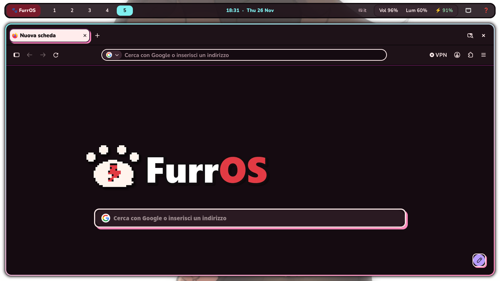

# FurrOS Firefox Theme

A dark Firefox theme inspired by [FurrOS](https://furros.xyz/): ink-bordered chips, sticker shadows, an oval address bar and a paw + FurrOS wordmark on the new tab page.



## Install

Extract the archive first, then run the installer for your system. The Linux and macOS installers can close a running Firefox safely.

### Linux

```bash
cd /path/to/FurrOS-firefox-theme
./install.sh
```

If the executable bit was lost, use `bash ./install.sh`. You can also double-click `install.desktop`.

### macOS

Double-click `install.command`, or run:

```bash
cd /path/to/FurrOS-firefox-theme
bash ./install.command
```

The Terminal window stays open when the installer finishes, so you can read the result. If it closes too fast, run `bash ./install.command` from Terminal. If macOS blocks the file, right-click it and choose **Open**. Intel and Apple Silicon are both supported. The installer works with macOS's built-in Bash 3.2 as well as newer Bash releases.

### Windows

Double-click `install.bat`, or run PowerShell:

```powershell
cd C:\path\to\FurrOS-firefox-theme
powershell.exe -NoProfile -ExecutionPolicy Bypass -File .\install.ps1
```

If Firefox has never been started on this Windows account, open it once and close it before installing, so its default profile exists.

## What the installer does

1. Finds Firefox, or installs it if it is missing.
2. Closes a running Firefox safely: `SIGTERM` first, `SIGKILL` only after a timeout, then waits for the profile locks.
3. Finds the profile Firefox actually uses. On Linux and macOS it starts Firefox once in headless mode and identifies the profile from the lock file it creates, so an outdated `installs.ini` or a first-run profile cannot send the theme to the wrong place. This fixes the old problem where the theme only worked after uninstalling Firefox.
4. Backs up existing `userChrome.css`, `userContent.css` and `user.js` as `.bak-DATE-TIME`, copies the theme and verifies it byte-for-byte.
5. Writes `~/FurrOS-install-report.txt` with the selected profile, container and Firefox binary.

Existing profiles and `profiles.ini` / `installs.ini` entries are preserved. Re-running the installer is safe: it reuses the same profile and only adds a new backup.

## Verify

Start Firefox. The address bar, panels and new tab page should use the FurrOS style. The report shows which profile was changed:

```bash
grep '^Profile:' ~/FurrOS-install-report.txt
```

If the UI does not change, open `about:profiles` in Firefox and check that the profile marked **This is the profile in use** is listed in the report. On macOS the installer themes every profile it can find, so that check is usually unnecessary; restart Firefox after installing. On Linux and macOS you can also run:

```bash
./diagnose.sh
```

## Uninstall

Linux and macOS:

```bash
./install.sh --uninstall
```

Windows:

```powershell
powershell.exe -NoProfile -ExecutionPolicy Bypass -File .\install.ps1 -Uninstall
```

Backups are kept.

## Notes

- `user.js` is applied on every start and overwrites the preferences it contains.
- All images are embedded in the CSS; there are no external assets or fonts.
- Run the installer as your desktop user, not with `sudo`/root, unless you really want to change root's profile.
- On Linux, system Firefox, Snap and Flatpak profiles are detected. With both a system and a Flatpak Firefox, open the browser you actually use before installing, or pass `--profile`.
- On macOS, profiles live in `~/Library/Application Support/Firefox`; Firefox can be installed in `/Applications` or `~/Applications`. By default the theme is applied to all detected profiles; use `--single-profile` to limit it to the one chosen by Firefox's headless probe. Set `FURR_MACOS_APPLICATIONS` to a colon-separated list of application folders to search for `Firefox.app` outside those two locations.
- On Windows, `profiles.ini` and `installs.ini` are read from `%APPDATA%\Mozilla\Firefox` and from Microsoft Store/MSIX packages.

## Options

```bash
./install.sh --profile /full/path/to/profile   # manual profile override
./install.sh --all-profiles                    # theme every detected profile
./install.sh --single-profile                  # macOS: only the detected profile
./install.sh --firefox-bin /path/to/firefox    # custom binary
./install.sh --force                           # close Firefox without asking
./install.sh --uninstall                       # remove the theme
```

`./install.sh --help` lists all options. PowerShell equivalents: `-Profile`, `-Force`, `-Uninstall`, `-SkipFirefoxInstall`.

## Tests

```bash
./tests/run-tests.sh
```

The suite runs offline and does not touch a real profile. It covers Linux, simulated macOS and simulated Windows/WSL detection, first-run profile creation, launcher behavior, Flatpak/Store paths, stale locks and byte-for-byte copies. It is also runnable with macOS's Bash 3.2. The theme has been checked end-to-end on macOS Apple Silicon; macOS Intel and Windows still need a manual check.

## Release

Release `v1.0.0` contains the theme and installers. Use the tag matching this checkout for a reproducible copy.
